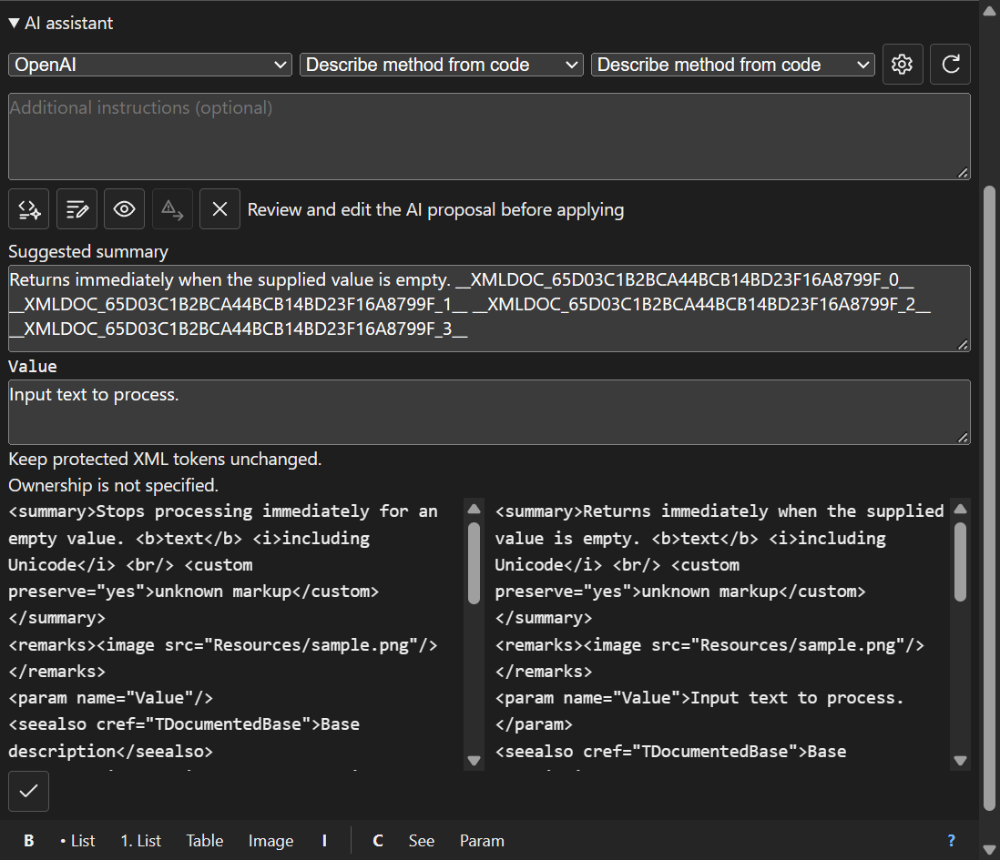

# XmlDoc Plugin for Delphi

[English](README.md)

Delphi IDE에서 `///` XML 주석을 편집하고 같은 주석으로 API 문서를 생성하는 플러그인입니다.

## 다운로드 및 설치

[최신 XmlDocPlugin-Setup.exe 다운로드](https://github.com/alexeydott/XmlDocPlugin/releases/latest/download/XmlDocPlugin-Setup.exe)

지원 환경은 **RAD Studio 12의 32비트 IDE**, **RAD Studio 13의 32비트 및 64비트 IDE**입니다.

1. 실행 중인 RAD Studio를 모두 닫습니다.
2. 설치 프로그램을 실행하고 감지된 IDE 버전을 선택합니다.
3. WebView2 Runtime이 없으면 설치를 허용합니다. 이 단계에는 인터넷 연결이 필요하며, 거절하면 설치가 취소됩니다.
4. IDE를 시작하고 **Document → Doc Inspector** 또는 **Documentation Explorer**를 엽니다.

설치는 현재 Windows 사용자에게 적용됩니다. 업데이트할 때도 IDE를 닫고 설치 프로그램을 실행합니다.
기존 사용자 설정은 유지됩니다. 제거하려면 IDE를 닫고 Windows의 설치된 앱에서 **XmlDoc Plugin**을 제거합니다.

## 사용자 가이드

[그림이 포함된 사용자 가이드](docs/user-guide.md)는 문서 편집, 초안 복구, 서명 동기화,
참조, 상속 문서, 재사용 문구, 용어, 예제, 텍스트 치환, 커버리지 및 문서 생성을 설명합니다.
IDE에서 **Document → User Guide**로 로컬 가이드를 열 수 있습니다. 가이드는 영어로 제공됩니다.

[작성 설정 예제](docs/examples/authoring.json)의 `authoring` 객체를 프로젝트의 기존
`.xmldocplugin.json`에 병합하면 재사용 문구와 용어를 설정할 수 있습니다.

## 인터페이스 언어

**Document → Settings → General → Language**에서 언어를 선택합니다.

- `en`: 영어
- `ko`: 한국어
- `ja`: 일본어
- `ru`: 러시아어
- `zh`: 중국어 간체
- `auto`: Windows 사용자 로캘에 맞춰 선택

한국어, 일본어, 러시아어, 중국어 번역이 패키지에 포함되어 있으며 별도의 언어 파일이 필요하지 않습니다.
`ko-KR`, `ja-JP` 등의 지역별 로캘도 해당 언어를 사용합니다. 알 수 없는 메시지는 영어로 표시됩니다.
메뉴, 설정, 생성/커버리지 대화 상자, Inspector/Explorer의 레이블과 SVG 툴팁에 적용됩니다.
설정을 확인하면 열린 편집기에 반영되고 새 대화 상자도 선택한 언어로 열립니다.
주석 내용, XML 태그, 코드 심볼, 파일 경로와 생성 프로젝트 이름은 번역하지 않습니다.
**Documentation tools**의 맞춤법 검사 언어는 별도 설정입니다.

번역 원본은 `resources/locales/ru.json`, `zh.json`입니다. 수정 후
`pwsh ./build-locales.ps1`을 실행합니다. 네이티브 빌드 전에 내장 사전의 일관성을 검사합니다.

## 문서 편집

- **Doc Inspector**는 소스 커서가 있는 선언을 표시하고 **Documentation Explorer**는 유닛 트리로 탐색합니다.
- TipTap/WebView2 편집기는 Summary, Remarks, 매개변수, 반환값, 타입 매개변수, 예제 및 참조를 지원합니다. 유닛 문서도 편집할 수 있습니다.
- **Applied**는 IDE 버퍼에 반영되었다는 뜻입니다. 디스크에 저장하려면 IDE에서 소스 파일을 저장합니다.
- 파일, 선언, 세션과 소스 리비전을 검사하여 오래된 편집이 다른 선언에 적용되지 않도록 합니다.
- 읽기 전용 버퍼, 읽기 전용/시스템 속성 파일 및 RAD Studio 소스는 조회만 가능합니다. 스텁과 일괄 쓰기도 차단합니다.
- **Pin**은 선언 또는 구현 위치를 유지합니다. 메타데이터 갱신 시 텍스트 Undo 기록을 유지합니다.
- XML 입력은 초안으로 저장되며 **Validate and apply XML**을 명시적으로 눌러야 적용됩니다.

### Documentation tools

대부분의 버튼은 SVG 아이콘이며 툴팁에 동작 이름을 표시합니다.

- **Recover drafts**: 원래 선언을 열고 원본 주석, 현재 주석, 저장된 초안을 비교합니다. 충돌을 검토한 뒤 적용합니다.
- **Synchronize signature**: 매개변수와 타입 매개변수를 맞춥니다. 이름 변경은 명시적으로 대응시키며 위치만으로 추측하지 않습니다.
- **Quick documentation**: 객체/지역 변수의 명시적 타입과 호출 인수로 멤버 및 오버로드를 찾습니다. 모호하면 후보를 선택합니다.
- **Project workspace**: 모듈, 프로젝트 또는 프로젝트 그룹에서 검색하고 참조를 삽입하거나 여러 멤버의 요약을 미리 보고 수정합니다.
- **Inheritance and reusable text**: 상속 문서의 빈 부분을 채우고 프로젝트/사용자별 문구 및 용어를 관리합니다.
- **Examples and search**: 선택한 코드를 예제로 삽입하거나 상대 경로와 region으로 예제를 연결하고 설명문 치환을 미리 봅니다.
- **Problems**: 잘못된 XML, 누락된 매개변수/결과, TODO, 참조 및 리소스 문제를 확인합니다.
- **Format**은 문서 XML을 정리합니다. Pascal 소스의 IDE Ctrl+D는 RAD Studio 12에서만 제공됩니다.

프로젝트 분석은 소스, 구성 및 읽은 의존성이 바뀐 모듈을 다시 파싱합니다. 진행률과 재사용 수를 표시하며
모듈 사이에서 취소할 수 있습니다. 상속 문서는 인덱스 레코드에서 다시 계산합니다.

## 문서 생성

**Generate API Documentation**에서 현재 프로젝트 또는 디렉터리, 출력 형식과 저장 경로를 선택합니다.

| 형식 | 결과 |
| --- | --- |
| HTML | 탐색 및 선택적 검색이 있는 다중 페이지 참조 |
| Markdown | 저장소/위키용 문서 |
| CHM | Windows 도움말; Microsoft HTML Help Workshop 컴파일러 필요 |
| JSON | 도구 연동용 `api.json` |
| Help & Manual | Topics, Baggage, 스키마와 스타일을 포함하는 HMXP 프로젝트 |
| MkDocs | 설정과 빌드 안내를 포함하는 사이트 프로젝트; Python 필요 |
| Docusaurus | 의존성과 빌드 안내를 포함하는 사이트 프로젝트; Node.js 필요 |
| VitePress | 의존성과 빌드 안내를 포함하는 사이트 프로젝트; Node.js 필요 |

노드는 모듈, 타입 종류, 타입, 멤버 종류별로 그룹화하고 알파벳순으로 정렬합니다.
CHM/HMXP 파일 이름은 소스 프로젝트 이름을 따릅니다. 제목 변경은 프로젝트 파일 이름을 바꾸지 않습니다.
이미지, 예제 및 생성 리소스를 함께 보관합니다.

**Use numeric topic file names** 또는 `--numeric-file-names`는 짧은 `t000001` 형식의 파일 이름을 사용합니다.
링크와 탐색도 같은 매핑을 사용합니다. 심볼 집합이 바뀌면 번호가 달라질 수 있으므로 전체를 다시 생성합니다.
`topic-map.json`에 매핑을 기록하며 HMXP에서는 Baggage에 저장합니다.
CHM은 항상 짧은 이름과 짧은 임시 빌드 경로를 사용합니다. 경로 제한, 컴파일러 부재 및 컴파일 실패는 오류로 보고됩니다.

## 명령줄 및 CI

설치 프로그램은 x64 생성기를 `%LOCALAPPDATA%\Programs\XmlDocPlugin\bin\XmlDocGen.exe`에 설치합니다.

```powershell
$generator = "$env:LOCALAPPDATA\Programs\XmlDocPlugin\bin\XmlDocGen.exe"
& $generator -p .\MyProject.dproj -o .\Generated `
  -f html,md,json,hmxp,mkdocs,docusaurus,vitepress,chm --numeric-file-names
& $generator -p .\MyProject.dproj -o .\Generated -f json --check
& $generator -p .\MyProject.dproj -o .\Generated -f json --check --write-baseline .\docs-baseline.json
```

CHM 컴파일러가 없으면 `chm`을 제외합니다. CLI는 디스크 파일을 읽으므로 IDE 버퍼를 먼저 저장합니다.
`--check`는 `diagnostics.json`을 기록하고 새 문서 문제가 있으면 종료 코드 3을 반환합니다.
기준선은 문제를 검토한 뒤 저장하고 `--baseline`으로 비교합니다.

## 빌드 및 테스트

필요한 도구는 RAD Studio 12/13, Node.js 18 이상, PowerShell 7 및 WebView2 Runtime입니다.
설치 프로그램 빌드에는 Inno Setup 6과 지원 대상 Delphi 컴파일러가 필요합니다.

```powershell
git submodule update --init --recursive
pwsh ./build-delphi12.ps1
pwsh ./build-cli.ps1 -Platform Win64
pwsh ./build-installer.ps1
pwsh ./tests/Test-Improvements.ps1 -SkipIDE
```

임시 빌드와 스테이징 디렉터리는 Git 밖에 생성됩니다. 설치 프로그램은
`XmlDocPlugin-Setup.exe`이며 공통 버전은 `installer/Version.txt`에서 관리합니다.

## 스크린샷


### AI assistant


## 기술 및 라이선스

Delphi OTA/VCL, WebView2, TipTap/TypeScript/Vite 및
[DelphiAST](https://github.com/alexeydott/DelphiAST)를 사용합니다.
네이티브 DUnitX, 브라우저/퍼즈 테스트와 IDE E2E 테스트를 포함합니다.

플러그인은 [MIT 라이선스](LICENSE), DelphiAST는 [MPL 2.0](vendor/DelphiAST/LICENSE)입니다.

## AI assistant

- **AI assistant** — Describe methods and undocumented parameters or rephrase summaries using configurable OpenAI-compatible profiles and prompts, with TOON context, optional request preview, configurable thinking control and automatic retries, cancellation, HTML cleanup and reviewed Apply. See the [user guide](docs/user-guide.md#use-the-ai-assistant).
