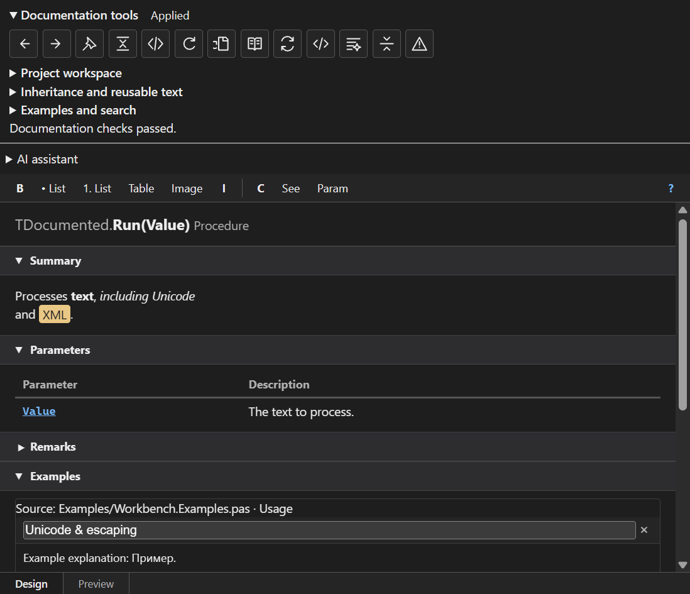
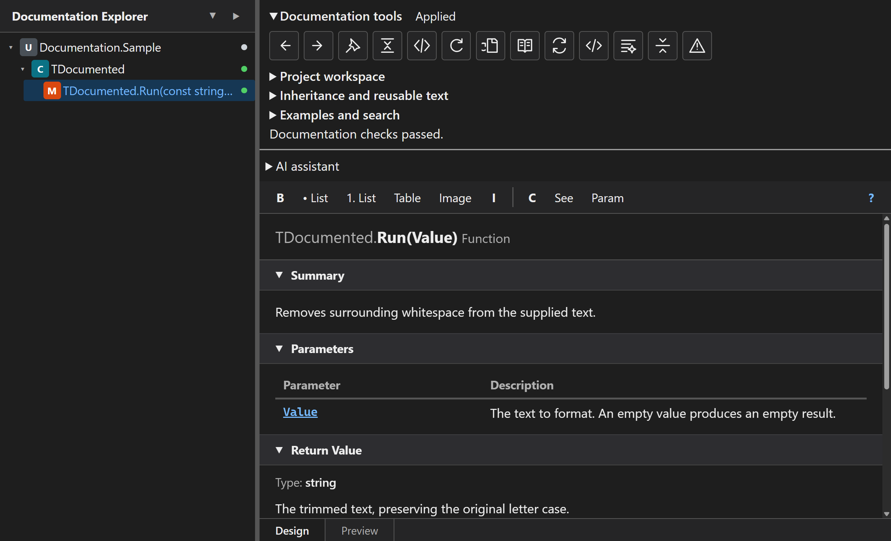

# XmlDoc Plugin for Delphi

An **XML Documentation** plugin integrated into the Delphi IDE. Write C#-style `///` XML comments with a WYSIWYG editor and generate full API documentation for your projects.

[한국어](README.ko.md)

## Download and Install

[Download XmlDocPlugin-Setup.exe from the latest release](https://github.com/alexeydott/XmlDocPlugin/releases/latest/download/XmlDocPlugin-Setup.exe)

The installer supports RAD Studio 12 (32-bit IDE) and RAD Studio 13 (32-bit and
64-bit IDEs).

1. Close all running RAD Studio instances.
2. Download and run `XmlDocPlugin-Setup.exe`.
3. If prompted, allow Setup to install Microsoft Edge WebView2 Runtime. This
   requires an Internet connection; declining cancels installation.
4. Select the detected IDE versions to install the plugin into and finish Setup.
5. Start RAD Studio. Open **Doc Inspector** to edit XML documentation, or use
   **Generate API Documentation** to export your project's documentation.

Installation is per user and does not require administrator privileges. To
update, close RAD Studio and run the latest installer. To uninstall, close RAD
Studio and remove **XmlDoc Plugin** from Windows Installed apps.

## User guide

Read the [illustrated user guide](docs/user-guide.md) to learn how to edit and
review comments, recover drafts, synchronize signatures, insert references,
edit member summaries, reuse inherited documentation, save wording and terminology,
add examples, replace prose, measure coverage, and generate documentation through the IDE or CLI.
Open it in the IDE with **Document → User Guide**.
A [project authoring configuration example](docs/examples/authoring.json) shows
how to configure reusable wording and terminology. Merge its `authoring` object
into your existing project settings.

## Documentation workbench

The latest installer includes the documentation workbench described below.

The Inspector and Explorer share overload-aware symbol identities and guarded
editing sessions. Every change records the source file, declaration, session and
buffer revision. A stale edit is rejected with **Source changed**; cancelled edits
remain recoverable drafts under `%LOCALAPPDATA%\XmlDocPlugin\Drafts`.

**Documentation tools** provides:

- Signature synchronization with an explicit rename preview. Unmatched parameter
  descriptions are retained until you decide how to map them.
- Documentation diagnostics, project and project-group search, filters, a next
  problem queue, navigation history and pinned documentation cards.
- A member-summary table with reviewed application of selected changes.
- A searchable reference picker that distinguishes overloads.
- Inherited documentation with source information and local section overrides;
  ambiguous inheritance requires an explicit source choice.
- Design, XML and Preview editing, rich parameter descriptions, lists, tables,
  project images, example titles, link captions and prose-only replacement.
- Project/global wording, Russian/English browser spell checking and project
  terminology. Code, XML references and known terminology are excluded from prose
  spell checking. Spell-check language availability depends on WebView2 dictionaries.
- Selected source as an example and linked example files/regions. Linked examples
  are checked for existence; arbitrary snippets are not compiled automatically.

Unknown XML and mixed content are preserved. Invalid XML remains available for
repair instead of becoming an empty comment. Formatting, synchronization and batch
operations show their XML changes before applying them. IDE source Undo/Redo uses
the existing undoable writer.

Documentation actions are available from the Document menu, IDE action catalog,
source editor context menu and Project Manager. Quick Documentation starts with
explicit type/member references and unique project types/units. Unqualified member
names are presented as candidates because local variables can shadow them. Explicitly typed object receivers, parameters and local variables are resolved,
and known argument types narrow overloads. Inline type inference and chained expressions
remain limited; unknown or ambiguous cases show candidates for an explicit choice.

IDE analysis uses the active project configuration/platform and current open
buffer snapshots. CLI analysis accepts `--config`, `--platform`, `--define` and
`--search-path`. Project evaluation supports ordered property/item groups,
property expansion and ordinary equality/boolean/Exists conditions; unsupported
MSBuild expressions produce an error instead of silently choosing a branch.

### Documentation checks in CI

```powershell
XmlDocGen.exe -p MyProject.dproj -o docs -f json --check
XmlDocGen.exe -p MyProject.dproj -o docs -f json --check --write-baseline docs-baseline.json
XmlDocGen.exe -p MyProject.dproj -o docs -f json --check --baseline docs-baseline.json
```

`--check` writes `diagnostics.json` and returns exit code **3** for new problems.
A baseline lets existing issues remain while rejecting new ones. Public
signatures removed or changed since the baseline produce **XD011**. Linked
resource problems produce **XD013**. Coverage distinguishes comments that exist,
structurally complete comments and comments that pass readiness checks; TODO
placeholders and the configured stub prefix do not count as finished documentation.
Use `--coverage-min` for comment presence and `--ready-min` for readiness (0–100);
a failed threshold returns exit code **1**. Pass `--placeholder-prefix` to use the
same custom marker as your IDE settings.

## Interface languages

Choose **Document → Settings → General → Language**. Built-in interface translations
are English (`en`), Russian (`ru`), and Simplified Chinese (`zh`). `auto` follows the
Windows user locale; regional codes such as `ru-RU` and `zh-CN` use the corresponding
language. Missing translations fall back to English. The legacy `ko` and `ja` choices are retained;
built-in dictionaries currently cover `en`, `ru`, and `zh`.

Language selection applies to plugin menus, settings, generation/coverage dialogs,
and Inspector/Explorer labels and SVG tooltips. Changes apply to open editors after
accepting Settings; newly opened dialogs use the selected language. Documentation
comments, XML tag names, symbols, paths, and generated project filenames are not
translated. Spell-check language is selected independently in Documentation tools.

The shared translation sources are `resources/locales/ru.json` and `zh.json`.
Run `pwsh ./build-locales.ps1` after changing them. Native build scripts check the
embedded dictionaries for consistency before compiling.

## Screenshots

### Doc Inspector


### Documentation Explorer


## Features

Quick documentation resolves explicit object/local-variable types and compares call
arguments when selecting overloads; ambiguous or unknown contexts require a choice.
Draft recovery opens the original declaration and compares the original comment,
current source, and draft before an explicit apply. Project workspace reuses parsed
modules when their sources, configuration and read dependencies match, reports progress,
and supports cancellation between modules. Effective documentation is rebuilt from the
indexed records so inherited comments reflect updated dependencies.


### IDE Plugin (BPL)

- **Doc Inspector** — A docking panel that provides real-time editing of XML documentation for the code element at the cursor position
- **Documentation Explorer** — Browse the entire unit's classes, methods, and properties in a tree view while editing their documentation
- **WYSIWYG Editor** — TipTap-based rich text editor rendered via TEdgeBrowser (WebView2)
- **Doc Stub Generation** — Generate documentation stubs with a single shortcut, including parameters, return types, and generic type parameters
- **Undocumented Element Navigation** — Jump sequentially through elements that lack documentation
- **Coverage Report** — Analyze and report documentation coverage across your project
- **Customizable Shortcuts** — All features are accessible via user-configurable keyboard shortcuts

### Documentation Engine (HelpGen)

- **Multiple Output Formats** — HTML, Markdown, CHM (Windows Help), JSON, Help & Manual (HMXP)
- **Theme Engine** — Select default, dark, high-contrast or minimal HTML/CHM themes in Settings; create and customize UTF-8 CSS themes. Project overrides and per-run selection are supported.
- **Cross-References** — Automatic link generation between types and members
- **Static Site Publishing** — Generate standalone API documentation sites

XML documentation immediately above a `unit` declaration is supported alongside
type and member documentation. Select the declaration or its `///` comment in
Doc Inspector, or select the unit root in Documentation Explorer, to edit its
summary, remarks, examples and related references. Saving updates the comment
above the declaration. Batch exports include this documentation on the module
page in every format, and Coverage Report includes the unit itself.

CHM and Help & Manual exports use the source project name, such as
`Project1.chm` and `Project1.hmxp`. The project name is also the
default documentation title; a custom title entered in the generation dialog
applies to all three static site formats.

Generated MkDocs, Docusaurus, and VitePress projects include English configuration,
dependency manifests, and a README with build and preview commands. MkDocs requires
Python 3.10 or later; Docusaurus and VitePress require Node.js 20 or later.

### CLI Tool (XmlDocGen)

```
XmlDocGen -d "C:\MyProject\src" -o "C:\MyProject\docs" -f HTML,MD
```

Generate documentation from the command line. Integrates with CI/CD pipelines.

Use `--numeric-file-names`, or select **Use numeric topic file names** in the
generation dialog, to name topic files `t000001`, `t000002`, and so on. This
applies to HTML, Markdown, CHM, HMXP, and all static site exports. Links and
navigation use the same mapping; displayed symbol names remain unchanged.
Numbering is reproducible for the same symbol set, but adding or removing
symbols can change numbers. Regenerate the entire output together.
HTML, Markdown, CHM, and site exports include `topic-map.json`; HMXP stores its
map in `Baggage/topic-map.json`. JSON remains a single `api.json` with logical
symbol names. Project filenames retain the source project name.

Navigation groups symbols by module, type category, type, and member category,
with alphabetical ordering. MkDocs uses page-level navigation and each type's
page table of contents for its members.

CHM always uses short topic filenames: stable hashes by default, numeric names
when requested. Compilation runs in a short temporary directory. Paths that
exceed the legacy compiler's 259-character usable path budget are rejected
with a clear error. Missing compilers, failed compilations, and invalid output
stop generation; compiler diagnostics are saved in `chm-compiler.log`.

## Supported XML Tags

| Tag | Description |
|-----|-------------|
| `<summary>` | Brief description of an element |
| `<param>` | Method parameter description |
| `<returns>` | Return value description |
| `<remarks>` | Additional notes |
| `<value>` | Property value description |
| `<typeparam>` | Generic type parameter description |
| `<exception>` | Possible exception documentation |
| `<example>` | Usage example |
| `<seealso>` | Related item reference |

```pascal
/// <summary>Retrieves information for the specified user.</summary>
/// <param name="AUserId">The ID of the user to look up</param>
/// <returns>User info, or nil if not found</returns>
/// <exception cref="EAuthException">Raised when not authenticated</exception>
function GetUser(const AUserId: Integer): TUser;
```

## Project Structure

```
src/
  Core/         Core modules (parser, model, codegen — shared by BPL and CLI)
  Plugin/       IDE plugin (BPL)
  HelpGen/      Batch documentation generation engine
  CLI/          Command-line tool
  Packages/     Delphi package project files
web/            TipTap WYSIWYG editor (TypeScript + Vite)
tests/          DUnitX unit tests
vendor/         External libraries (DelphiAST)
docs/           Generated API documentation
resources/      Built web resources
```

## API reference

The [generated API reference](docs/README.md) covers the current units and public
declarations in `src`. Browse [HTML](docs/index.html) or Markdown pages under
`docs/units`. Regenerate it with `./build-api-docs.ps1`; staging files and compiler
outputs remain outside the checkout. The script validates unit coverage, local
resources and HTML link anchors before replacing generated pages.

See [Settings](docs/user-guide.md#settings) for the supported options and their effects.

## Building

### Prerequisites

- RAD Studio 12 (32-bit IDE) or RAD Studio 13 (32-bit or 64-bit IDE)
- Node.js 18+ (for building the web editor)
- Microsoft Edge WebView2 Runtime (Setup offers to install it when missing)
- PowerShell 7 (`pwsh`) for build scripts and the offline guide
- Python 3.9+ for API reference validation (`build-api-docs.ps1`)

### Build Steps

```powershell
# Run from the repository root after cloning with submodules.
git submodule update --init --recursive
pwsh ./build-delphi12.ps1
pwsh ./build-cli.ps1 -Platform Win64
# Build all supported IDE packages, the CLI, offline help and Setup.
pwsh ./build-installer.ps1
```

For Delphi 12.x, run `pwsh -File .\build-delphi12.ps1` from the
repository root, or open `src/Packages/12/XmlDocPlugin.dproj` in the IDE.
Delphi 12 uses a Win32 design-time package, including on 64-bit Windows.
The script builds both web pages and their resources, compiles the package,
and places the official x86 `WebView2Loader.dll` and its license beside the BPL.
Use `-Bds` to select the Delphi installation and `-OutputDir` to select another
BPL directory. Install the resulting `XmlDocPlugin290.bpl` and restart the IDE.
The Microsoft WebView2 Runtime must also be installed.

Inspector and Explorer follow the current IDE theme, including native error
panels. Theme changes also apply to panels that are already open.
Section expansion choices are saved separately for each editor. Docking is
stored in the IDE desktop layout and follows the IDE's layout save/restore settings.

## Help & Manual export

Select **Help & Manual (HMXP project)** in **Generate API Documentation**, or run:

```powershell
.\build-cli.ps1 -Platform Win64
& "$env:LOCALAPPDATA\XmlDocPlugin\CLI\Win64\XmlDocGen.exe" `
  -d "C:\MyProject\src" -o "C:\MyProject\docs" -f hmxp -t "My API"
```

`build-cli.ps1 -Platform Win64` builds the 64-bit CLI. The `helpmanual` format
name is also accepted. The CLI and IDE produce the same project structure:

```text
hmxp/
  Documentation.hmxp
  Maps/table_of_contents.xml
  Topics/T<symbol-id>.xml
  Images/
  Baggage/
  helpproject.xsd
  xml.xsd
  helpproject.xsl
```

Open `hmxp/Documentation.hmxp` in Help & Manual. The project contains the current
documentation title, a hierarchical table of contents, editable topic content,
styles, keywords, and links between exported symbols. Overloads have separate
stable topic IDs. Private symbols are omitted unless requested. Unresolved
references remain readable text. Each export lists its topic files explicitly
and removes obsolete topics previously generated by this exporter.

The Help & Manual table of contents groups symbols by module, then by type
(classes, interfaces, records, and other types). Each type groups its members
into constructors, destructors, methods, properties, fields, and constants.
Module routines, constants, and variables have separate sections. Entries
within each group are sorted alphabetically; nested types stay under their owner.

When exporting a `.dproj`, `.dpr`, or `.dpk` project with `-p` or **Current Project**
in the IDE, the output filename follows that project name. For example,
`Project1.dproj` produces `hmxp/Project1.hmxp`. Directory exports
retain the default `Documentation.hmxp` filename.

The schema and preview stylesheet are bundled from the supplied XML reference.
The exported stylesheet reads **this generated project**, and schema imports
resolve locally. The complete directory can be moved to another machine.
To validate its project, topics, styles, links, and XSL previews offline:

```powershell
.\tests\Validate-HMXP.ps1 "C:\MyProject\docs\hmxp\Documentation.hmxp"
```

## Conditional compilation diagnostics

`DECLARED` automatically resolves visible local declarations, exported declarations
from directly imported source units, and inherited class members, respecting
private and strict-private visibility. No callback is required when dependency
sources are available. The parser searches beside the current source, configured
`SearchPaths` and `SourceFiles`, and the matching RAD Studio source tree. Implicit
`System` declarations use inventories generated by the native target compiler
with `tools/Generate-SystemDeclarations.ps1`. Known built-in `SizeOf` expressions
in RTL conditionals are evaluated with native target sizes; unsupported
expressions remain explicit errors.

Pass the source filename to `ParseSource` so relative imports and includes can be
resolved. Source with `DECLARED` is reparsed even when unchanged, since dependency
files may have changed. `OnResolveDeclaration` remains an optional integration
hook for declarations unavailable as source.

Unresolved declarations and invalid conditional expressions produce errors.
Inspector and Explorer display a diagnostic instead of stale documentation;
batch generation and coverage analysis stop with the failing source filename.
Qualified `DECLARED(Type.Member)` expressions are not supported by Delphi and are rejected by the
conditional-expression grammar and are reported as errors. Existing
DelphiAST `$IFOPT` limitations still apply.

## Tech Stack

The parser in `vendor/DelphiAST` is a Git submodule pinned to a tested commit of
the maintained fork. Initialize dependencies after cloning or pulling:

```powershell
git submodule update --init --recursive
```

For a new checkout, use `git clone --recurse-submodules`.
Parser changes, attribution and cross-compiler/fuzz test instructions are in
[DelphiAST UPSTREAM.md](https://github.com/alexeydott/DelphiAST/blob/master/UPSTREAM.md).

| Area | Technology |
|------|------------|
| IDE Plugin | Delphi OTA (Open Tools API), VCL |
| Source Parsing | [DelphiAST maintained fork](https://github.com/alexeydott/DelphiAST) |
| Doc Editor | [TipTap](https://tiptap.dev/) + TypeScript, WebView2 |
| Build Tool | Vite + vite-plugin-singlefile |
| Testing | DUnitX |

## License

This project is licensed under the [MIT License](LICENSE).

- DelphiAST: [MPL 2.0](vendor/DelphiAST/LICENSE)

## Binary installer for RAD Studio 12 and 13

Build a single Inno Setup installer containing native packages for the 32-bit
IDE of RAD Studio 12 and the 32-bit and 64-bit IDEs of RAD Studio 13:

```powershell
.\build-installer.ps1 -Rad12 'D:\Embarcadero RAD Studio\23.0' `
  -Rad13 'D:\Embarcadero RAD Studio\37.0' `
  -ISCC 'D:\tools\InnoSetup\6\ISCC.exe'
```

The build requires both RAD Studio toolchains, Inno Setup 6, Node.js/npm, and
Internet access on the first build. It verifies the WebView2 SDK checksum and
the Microsoft signature of the Evergreen Runtime bootstrapper. The output is
`XmlDocPlugin-Setup.exe` in the repository root. Only this binary is allowed
through the executable ignore rule; staging files, intermediate binaries and
checksums stay under `%LOCALAPPDATA%\XmlDocPlugin\Installer`.

The single source of the four-part product version is `installer\Version.txt`.
`build-version.ps1` validates it and handles explicit version changes and
increments. Both BPL projects import `XmlDoc.Version.props`, including when
built directly in the IDE. The CLI build generates its Windows version resource
outside Git. About displays all four components from the loaded BPL metadata.

Use `-IncrementVersion` to increment the last component, or `-Version 1.2.0.0`
to set a release version. An explicit change is persisted before compilation so
all builds consume the same value. The installer build rejects mismatched
FileVersion or ProductVersion in any BPL, CLI or Setup executable. The filename
stays `XmlDocPlugin-Setup.exe`. Use `-OutputDir` to change its destination.

```powershell
.\build-installer.ps1 -IncrementVersion
.\build-installer.ps1 -Version 1.2.0.0
# Set the shared version without building:
.\build-version.ps1 -Version 1.2.0.0
```

Setup detects installed IDEs using their registry configuration and checks that
`bin\bds.exe` or `bin64\bds.exe` exists. Only detected targets can be selected.
All RAD Studio instances must be closed before installation or removal. Setup
never closes the IDE automatically. Files and package registrations belong to
the current user; administrator privileges are not required.

If WebView2 Runtime is missing, Setup asks to install it using Microsoft's
Evergreen bootstrapper, which requires Internet access. Declining or failing
to install the Runtime stops Setup before plugin installation. For unattended
installation, explicitly permit Runtime installation with
`/VERYSILENT /SUPPRESSMSGBOXES /INSTALLWEBVIEW2=1`; without that permission,
missing WebView2 causes Setup to exit. The runtime detection and deployment
follow [Microsoft's WebView2 distribution guidance](https://learn.microsoft.com/en-us/microsoft-edge/webview2/concepts/distribution).

Setup replaces older XmlDocPlugin registrations for selected targets and
remembers them. Uninstall removes this installation's registrations and restores
the previous ones. User documentation and editor preferences are preserved.
The Runtime is shared with other applications and is not removed on uninstall.

Setup also installs the standalone 64-bit command-line generator in
`%LOCALAPPDATA%\Programs\XmlDocPlugin\bin\XmlDocGen.exe`. It runs independently
of the IDE; installation requires 64-bit Windows. For example:

```powershell
& "$env:LOCALAPPDATA\Programs\XmlDocPlugin\bin\XmlDocGen.exe" `
  --project 'C:\MyProject\MyProject.dproj' --output 'C:\MyProject\docs' `
  --format html,hmxp --numeric-file-names
```

The CLI is updated with the plugin and removed on uninstall. Setup does not
change `PATH`; use the full executable path in scripts.

Run `installer\Test-Installer.ps1` after building to exercise detection failures,
Runtime consent/failure handling, installation, upgrade, payload hashes and
architectures, and restoration on uninstall. Tests use unique temporary registry
keys and a deterministic Runtime fixture; they do not change real IDE or
WebView2 registrations. Installer source is `installer\XmlDocPlugin.iss`.
The [InnoSetupScripts RAD Studio helpers](https://github.com/civilian7/InnoSetupScripts/tree/main/Source)
were consulted for RAD Studio version and registration conventions.

### Protected source files

Documentation in read-only IDE buffers, files with read-only or system attributes,
and RAD Studio compiler source directories is available for viewing and navigation.
Documentation editing, stub generation and batch changes are blocked for these files,
including requests sent directly to the native plugin. Existing drafts are retained
but are not applied while viewing a protected source file.

The parser evaluates supported RTL `SizeOf` conditionals for the selected target
platform when opening compiler sources directly or through imports and includes.
It also resolves the literal bounds of `RegisteredTypeInfoTable` used by System.pas.
Unsupported conditional expressions continue to report errors.
