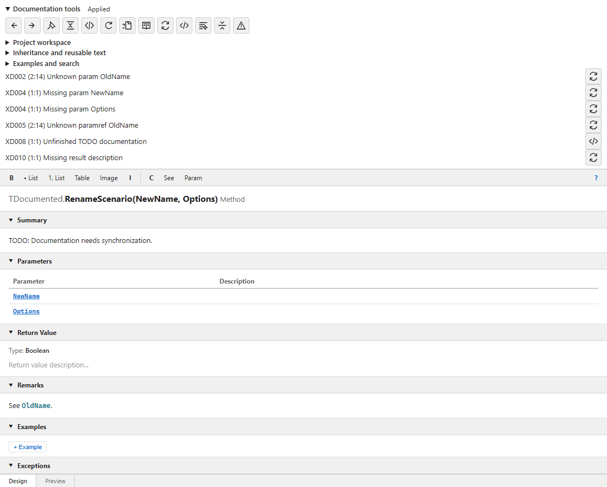
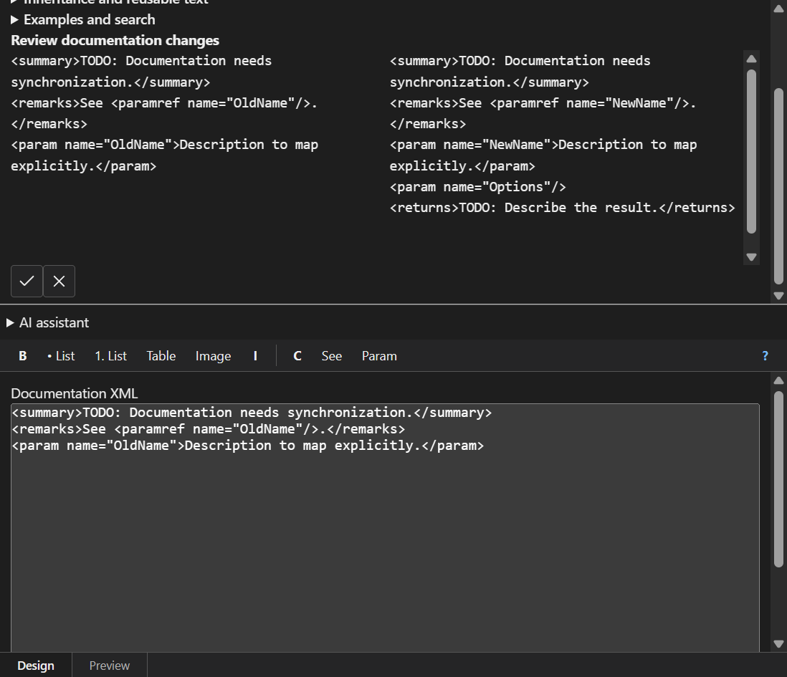
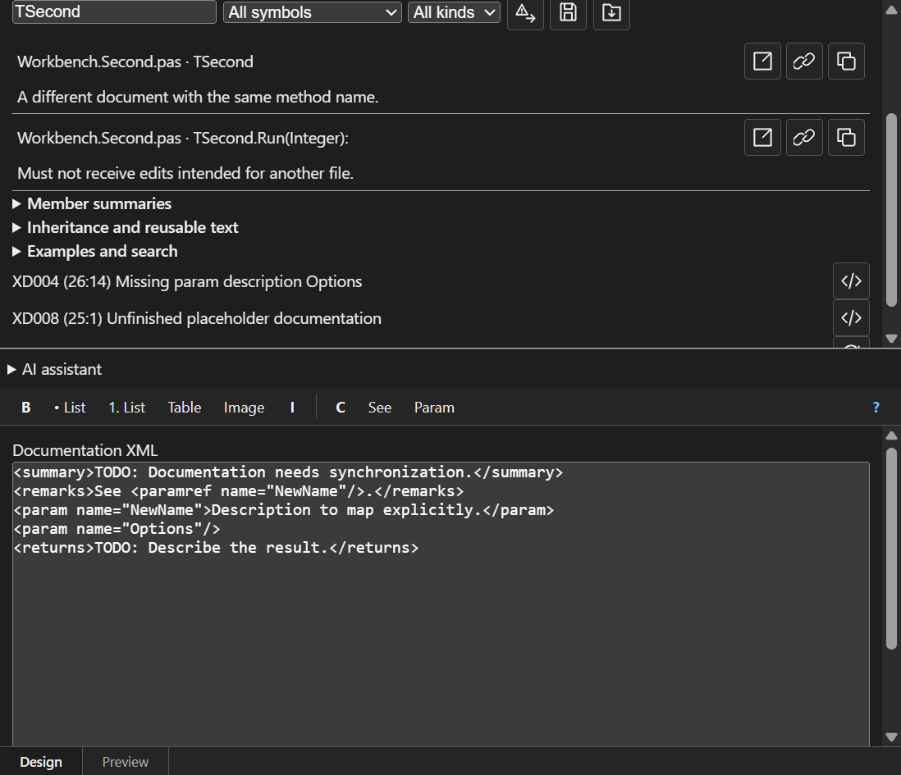
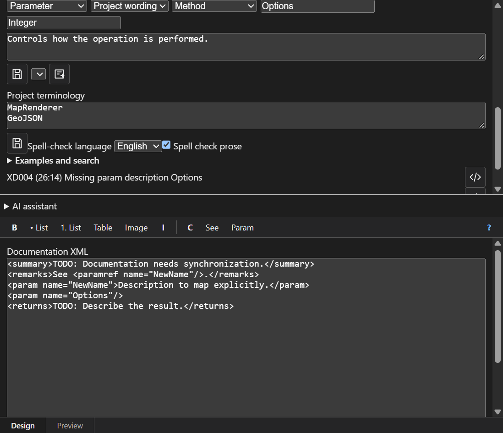
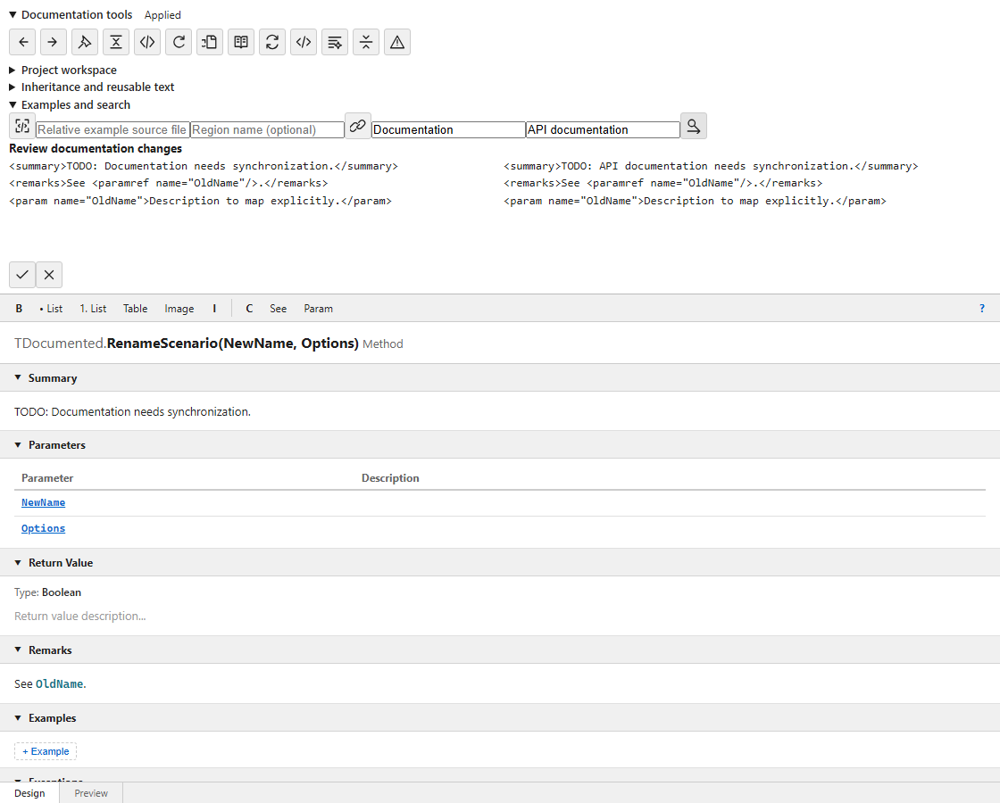

# XmlDocPlugin user guide

XmlDocPlugin edits Delphi `///` XML documentation in the IDE and generates API reference documentation from the same source comments.

## Contents

- [Install and open the editor](#install-and-open-the-editor)
- [Settings](#settings)
- [How editing works](#how-editing-works)
- [Write and review a comment](#write-and-review-a-comment)
- [Documentation tools](#documentation-tools)
- [Recover drafts](#recover-drafts)
- [Synchronize a changed signature](#synchronize-a-changed-signature)
- [Find declarations and insert references](#find-declarations-and-insert-references)
- [Edit member summaries together](#edit-member-summaries-together)
- [Reuse inherited documentation](#reuse-inherited-documentation)
- [Save wording and terminology](#save-wording-and-terminology)
- [Add examples and replace prose](#add-examples-and-replace-prose)
- [Measure coverage and check problems](#measure-coverage-and-check-problems)
- [Generate documentation](#generate-documentation)
- [Use the command line](#use-the-command-line)
- [Troubleshooting](#troubleshooting)

## Install and open the editor

1. Download [XmlDocPlugin-Setup.exe](https://github.com/alexeydott/XmlDocPlugin/releases/latest/download/XmlDocPlugin-Setup.exe), close RAD Studio, and run Setup. Choose the detected IDE installations. Supported IDEs are RAD Studio 12 (32-bit) and RAD Studio 13 (32-bit and 64-bit).
2. Allow installation of Microsoft Edge WebView2 Runtime if requested. Declining cancels installation.
3. Open your Delphi project and a source unit, then put the caret on the declaration you want to document.
4. Use **Document → Doc Inspector**. For a unit-wide tree, open **Documentation Explorer**. Shortcuts are configurable; use the menu labels or action hints to find the assigned keys.
5. Open this guide from **Document → User Guide** whenever you need instructions.

Choose **Document → Settings → General → Language** for the interface language:
`en` (English), `ru` (Russian), `zh` (Simplified Chinese), `ko` (Korean),
`ja` (Japanese), or `auto` (Windows user locale). All four translation packs are included.
Unavailable translations use English. This changes plugin captions and tooltips,
not your comments, XML tags or source symbols. The spell-check language in
Documentation tools is a separate setting. This guide uses the English action names.

## Settings

Open **Document → Settings**. The editor theme follows the current IDE theme.

| Tab | Setting | Effect |
| --- | --- | --- |
| General | Font Size | Changes the embedded editor text size. |
| General | Language | Selects the plugin interface language without translating source identifiers or documentation text. |
| General | Collapse empty sections | Starts empty sections collapsed. Sections you explicitly open or close retain their saved state. |
| General | Show signature header | Shows or hides the selected declaration's signature above its documentation. |
| Code Generation | Generate a stub after typing /// | Expands a new triple-slash line above an undocumented declaration. Existing comments are not replaced. |
| Code Generation | Default HTML / CHM theme | Chooses the global documentation output theme. |
| Code Generation | Create CSS theme | Saves a new theme based on the selected palette and selects it in the list. Accept Settings to retain that selection. |
| Code Generation | Unfinished documentation markers | One marker per line, used by diagnostics, readiness, coverage and the draft filter independently of the generated prefix. Defaults include English, Russian, Chinese, Korean and Japanese markers. Edit the list to add project conventions or remove unwanted markers. The current generated prefix and legacy `TODO` are always recognized. |
| Code Generation | Placeholder Prefix | Sets the prefix for generated descriptions that still need writing; defaults to `TODO: `. Applies to menu-generated stubs and the Inspector and Explorer stubs too. The configured prefix and legacy `TODO` markers remain unfinished in diagnostics, filters and coverage. An empty prefix retains `TODO: ` when placeholders are enabled. |
| Shortcuts | Command bindings | Assigns shortcuts after checking for conflicts with IDE commands. |
| Advanced | Debounce (ms) | Delay before processing editor cursor and source notifications. |
| Advanced | Save Debounce (ms) | Delay before sending a documentation edit to the IDE source buffer. |
| Advanced | Log Level | Minimum severity written to the plugin log; changes take effect when settings are accepted. |

Global preferences are stored under `HKEY_CURRENT_USER\Software\XmlDocPlugin`.
The default log is `XmlDocPlugin\xmldocplugin.log` beneath the Windows user home directory.
Legacy automatic-update, automatic-opening and comment-formatting values remain in the
registry for compatibility, but are not offered as supported controls. Use the
Document menu to open views. Source indentation and XML preservation follow the
source-editing implementation rather than the retired formatting preferences.

Project generation defaults belong in `.xmldocplugin.json` beside the project.
The `helpGen.defaultFormats` array selects formats initially checked in Generate
API Documentation (`html`, `chm`, `md`, `json`, `hmxp`, `mkdocs`, `docusaurus`, `vitepress`).
`helpGen.coverageMinPercent` sets **Minimum comment presence (%)**: it counts declarations with a comment, including unfinished comments. `helpGen.readyMinPercent` sets **Minimum ready documentation (%)**: it requires complete descriptions without unfinished placeholders or diagnostic problems. These separate controls are available in Generate API Documentation. Zero disables the corresponding threshold. The optional coverage report checkbox controls report creation independently of the thresholds. The CLI uses its command-line options instead.

## How editing works

Comments belong to the declaration immediately below them. The Delphi parser supplies the declaration kind, signature, parameters and source position. Inspector follows the source caret; Explorer lets you select a declaration in the current unit tree. Unit comments are supported as well as type and member comments.

The editor updates the IDE source buffer after a short pause. **Applied** means the plugin accepted the update into that buffer; save the Delphi file normally to persist it to disk. Use the IDE's source Undo/Redo to undo accepted changes.

An edit is associated with its file, declaration, session and source revision. If source changes underneath an operation, the plugin rejects a stale write instead of applying it to another declaration. Reload the source and review the draft again. A preview is not an accepted edit: use **Apply changes** only after checking it.

Read-only files, read-only IDE buffers and sources under installed RAD Studio source directories are view-only. Navigation and inspection remain available; documentation changes, stubs and batch writes are blocked. Use a writable project source file when editing documentation.

## Write and review a comment



*An unfinished method comment, with signature diagnostics above the Design editor.*

1. Select an undocumented declaration and generate a documentation stub from the Document menu if needed.
2. Enter a concise **Summary** describing the operation. Use **Remarks** for context, limitations and usage details.
3. For methods, document each **Parameters** row and the **Return Value** for functions. Double-click a parameter row to navigate to its owning method in source.
4. For generic declarations, document **Type Parameters**; for properties, use **Value**. Add exceptions only where applicable to the declaration. Unit documentation does not have an Exceptions editor.
5. Use the formatting toolbar for emphasis, lists, tables, inline code, references and project images. A code sample belongs in Examples rather than a prose paragraph.
6. Switch to **Preview** to see rendered documentation. Use the **XML** action for the underlying XML fragment, then **Validate and apply XML** to accept a correction.
7. Wait for **Applied**, inspect the source comment, and save the file in the IDE.

XML fragments omit an enclosing `<doc>` element. Escape literal markup in XML (`&lt;`, `&amp;`). Unknown XML and mixed content are retained; malformed comments remain available in XML view for repair. Preview is useful for appearance, while Problems checks structure and references. An unapplied XML draft remains visible in XML view when a Design edit is acknowledged; it is separate from the accepted source version until you explicitly apply or discard it.

## Documentation tools

Expand **Documentation tools** above the editor. Most actions use SVG icons. Hover an icon or focus it with the keyboard to read its tooltip; this guide uses those action names.

| Action | Use |
| --- | --- |
| Back / Forward | Revisit documentation selections; also Alt+Left / Alt+Right inside the editor. |
| Pin | Keep the current documentation card while moving the source caret. Unpin to follow source again. |
| Compact | Reduce editor spacing. |
| Source | Navigate to the selected declaration. |
| Reload source | Discard the pending editor view and request current source. Review recoverable drafts separately if needed. |
| Recover drafts | List saved drafts for the active project. |
| Quick documentation | Resolve the symbol at the source caret or offer matching declarations. |
| Synchronize signature | Review missing, obsolete or renamed parameter/result sections. |
| XML | Open the raw documentation fragment; Ctrl+Alt+X inside the editor also opens it. Escape returns to Design. |
| Format | Preview XML formatting before applying it. |
| Fold source comments | Request folding of documentation comments in the source editor. |
| Problems | Show checks for the selected declaration and actions for resolving them. |

The Documentation tools **Format** action formats the documentation XML. The IDE **Format Source / Ctrl+D** command formats Pascal source and is available in RAD Studio 12; RAD Studio 13 does not include that built-in formatter.

The expandable sections below these actions are **Project workspace**, **Inheritance and reusable text**, and **Examples and search**. **Review documentation changes** appears when an operation has something to preview. The left XML is the current comment; the right XML is the proposed replacement. The checkmark applies it and the cross cancels it.

## Recover drafts

Drafts preserve editor work that has not been accepted by the source writer. They are local recovery data, not a replacement for saving source or version control.

1. Open the project that owns the source file.
2. Choose **Recover drafts**.
3. Find the entry by source file and symbol and choose **Review against current documentation**. The plugin opens the saved declaration, including its original interface or implementation section.
4. Compare **Original comment**, **Current source comment**, and **Saved draft**. A conflict message explains when the source comment changed after the draft was created. Apply the recovered draft explicitly only after reviewing that change. If the declaration was renamed or removed, recovery reports the problem and keeps the draft.
5. Save the source file normally after it is applied.

Drafts are stored under `%LOCALAPPDATA%\XmlDocPlugin\Drafts`. A stale source revision can leave a draft recoverable even when its automatic update was rejected. Reloading source does not mean an old draft should be applied blindly. Protected source files stay view-only even if a draft exists for them. Legacy drafts without a stable source-location identity are retained for manual recovery from that folder; they cannot be automatically applied to a guessed declaration.

## Synchronize a changed signature

When you rename a parameter, synchronize the documentation to keep parameter descriptions and inline references consistent. For example, if `OldName` becomes `NewName`:

1. Select the changed method and choose **Synchronize signature**.
2. In **Map OldName**, explicitly select `NewName`. Leaving **Keep unmatched description** retains the old description for you to resolve; the plugin does not guess that a rename is safe.
3. Choose **Preview synchronization**.
4. Check that the `param` name and `paramref` in Remarks change together. Review any added parameter and result sections.
5. Apply, then replace any empty descriptions or TODO result text with meaningful documentation.



*The explicit OldName → NewName mapping preserves the description and updates the parameter reference. Added sections still need useful prose.*

Synchronization fixes structure, not the meaning of the prose. Run Problems again after completing the text.

## Find declarations and insert references



*Searching for Run shows the base declaration, interface contract and both sample overloads.*

1. Expand **Project workspace**. Choose **Module**, **Project**, or **Project group**, then **Refresh**. Analysis displays its progress and how many modules were parsed or reused. **Cancel analysis** stops between modules and keeps the previous completed catalog. Modules are reused only when their source, project configuration and actually read dependencies (including closed includes and imported `DECLARED` sources) still match; effective documentation is recomputed from the indexed modules.
2. Type a symbol name or documentation phrase. Narrow results with **Symbol kind** and the documentation filter: public API, no documentation, TODO drafts, incomplete signature, reference problems or new problems.
3. Use a result's **Open source** icon to navigate. Check the full signature when overloads share a name.
4. To insert an inline reference, place the editor caret where it belongs, optionally enter **Reference display text**, then choose the result's **Reference** icon. The caption and reference target are separate.
5. Use **Next problem** to cycle through declarations in the current filtered set that are not ready.

Quick documentation starts from the source caret. When a name or overload cannot be resolved uniquely, choose a candidate rather than assuming the first match is correct. Quick documentation resolves explicit parameter and local-variable types, `Self`, and inherited members. It compares argument types to select an overload, including integer, hexadecimal, string and Boolean literals. Unknown receiver types, incomplete argument lists and ambiguous overloads require an explicit choice; inferred inline-variable types, expression chains and compiler conversions beyond the supported primitive types still require the project picker.

## Edit member summaries together

1. Select a member or its owning type and expand **Project workspace → Member summaries**.
2. Clear the search or choose filters that include the members you want. The table follows the filtered catalog.
3. Select the rows to change and edit their summary XML fragments.
4. Choose **Preview selected summaries**, review each declaration and before/after comment, and apply.

Only selected summaries are submitted. Other documentation sections remain part of each comment. Protected rows cannot be selected for writing. The source writer rechecks the files before application. While it acknowledges a batch and refreshes the catalog, you can continue typing; the next text is retained and the next batch uses the acknowledged source version. Filtering or paging does not discard pending text or row selections.

If the source comment changes externally, use the row's **Review current source** icon to compare the current comment with your pending summary. Apply that review to accept the new baseline, then preview and apply the selected summaries. Reviewing the baseline itself does not write to source.

## Reuse inherited documentation

Select a method inherited from a base class or implementing an interface, then expand **Inheritance and reusable text**. If both ancestors provide documentation, an unqualified `<inheritdoc/>` can be ambiguous.

- Inspect the listed inheritance sources and use **Open source** to check the contract.
- **Copy missing sections** previews copying available text while preserving existing local sections.
- For a live inheritance relationship, use XML view to give `<inheritdoc cref="..."/>` an explicit, unambiguous source. Use the symbol picker to identify the intended declaration.
- Local Summary, Remarks or other sections can override inherited text. Check the generated documentation as well as the local comment.

A result's **Copy documentation** action copies documentation into the current declaration through a preview. If parameter names differ, review the explicit mappings. A copy is independent text; it is different from retaining an `inheritdoc` relationship.

## Save wording and terminology

Wording templates fill empty sections with reusable **plain text**. They do not overwrite an existing description and do not expand variables such as `{Name}`. Use the XML editor for XML markup.



*Project-scoped wording for the Integer Options parameter, plus known project terminology.*

To save reusable wording for an `Options: Integer` parameter:

1. Expand **Inheritance and reusable text**.
2. Choose section **param**, scope **Project wording**, element kind **method**, parameter name **Options** and type **Integer**.
3. Enter `Controls how the operation is performed.` and choose **Save wording**.
4. Select the saved entry and choose **Fill empty section**.
5. Review the XML and apply. An existing nonempty Options description is preserved.

A name pattern supports `*` (for example `A*`); matching is case-insensitive. A type filter matches the whole type text, case-insensitively. Leave the element kind, name or type blank to broaden matching. For ordinary Summary/Remarks/Returns/Value wording, choose the relevant section; the destination must be empty. Parameter and type-parameter wording is applied to matching declared parameters with empty descriptions.

**Project wording** is saved in `.xmldocplugin.json` beside the active project and can be shared in version control. **Global wording** is saved for the current Windows user and can be reused across projects. Saving appends a wording entry. To maintain a project template collection, edit its `authoring.templates` array with the IDE closed or reload authoring afterwards.

Enter **Project terminology** one word per line, then **Save terminology**. Choose English or Russian and enable **Spell check prose** as needed. Dictionary availability depends on WebView2. Code, XML references and known terminology are excluded from prose spell checking; terminology does not rename code or replace documentation text.

See [the authoring configuration example](examples/authoring.json). To use it, merge only its `authoring` object into the existing project `.xmldocplugin.json`, preserving every other key (including generation settings). If no configuration exists, copy the example to `.xmldocplugin.json` beside your project. Reopen the documentation view to reload it.

## Add examples and replace prose

### Examples

- Select source code in the IDE, then choose **Insert selected source as example**. Review the proposed example before applying it. This creates a snapshot; later source changes do not update that copied code.
- For a linked example, enter `Examples/Usage.pas` and region `Usage`, then choose **Preview linked example**. Review and apply the generated `example source` and `region` attributes.
- Use paths relative to the project. Absolute paths and parent-directory traversal are rejected by the linked-example action.
- Add a title and explanation to make examples useful independently of their code. Keep referenced images and example files with the project.

Linked resources are checked for availability. The plugin does not automatically compile arbitrary snippets in documentation.

### Prose replacement

1. Select the declaration to change and expand **Examples and search**.
2. Enter `Documentation` in **Find in documentation** and `API documentation` in **Replacement**.
3. Choose **Preview replacement** and inspect the before/after XML.
4. Apply or cancel.



*Replacement changes the summary prose while retaining the OldName reference and parameter markup.*

Replacement is a literal, case-sensitive operation on the **current comment**, not a project-wide regular-expression replacement. It leaves XML names/attributes, code, inline code and reference nodes intact. Repair malformed XML first. A phrase inside a code example or reference caption may therefore intentionally remain unchanged.

## Measure coverage and check problems

Use **Coverage Report → Analyze** for the current project or a selected directory. Inspect the declaration list and source positions rather than relying only on a percentage. Coverage distinguishes a comment that exists, a structurally complete comment and documentation that passes readiness checks; Generated placeholders using your configured prefix, as well as existing TODO placeholders, are unfinished.

Use **Problems** for the current declaration and project filters for a wider cleanup pass. Typical findings include invalid XML, missing/obsolete parameters, unresolved references, missing result documentation, TODO text, public API changes and missing linked resources.

**Save baseline** in Project workspace downloads a JSON snapshot of current issues and public symbols. **Load baseline** compares against a previous snapshot; **New problems** filters findings outside that baseline. A baseline records accepted existing debt rather than fixing it. Keep the baseline under version control if the team uses it for review.

## Generate documentation

1. Open **Generate API Documentation** from the Document menu.
2. Select **Current Project** for the active project, or choose a directory. IDE project analysis uses the active configuration/platform and open buffer snapshots.
3. Select the output formats, destination and options. Check exclusions, visibility, interface-only analysis, title, search index and coverage settings for your intended audience.
4. Select **Use numeric topic file names** to keep topic paths short across exports.
5. Generate, inspect the reported errors, then open the output and test representative cross-references and images.

| Format | Deliverable and use |
| --- | --- |
| HTML | Multi-page reference with navigation and optional search; preserve its supporting assets. |
| Markdown | Pages for a repository/wiki workflow; preserve relative links and resources. |
| CHM | `MyProject.chm`; needs Microsoft HTML Help Workshop's compiler. Failed or missing compilation is an error. |
| JSON | `api.json` for further tooling; logical names remain intact. |
| Help & Manual | `MyProject.hmxp` with Topics, Baggage and supporting project resources. Open the project in Help & Manual and keep the directory together. |
| MkDocs | Generated site project with configuration, documentation and build instructions; requires Python. |
| Docusaurus | Generated site project with dependency manifest and build instructions; requires Node.js. |
| VitePress | Generated site project with dependency manifest and build instructions; requires Node.js. |

Navigation groups declarations by module, type category/type and member category with alphabetical ordering. MkDocs uses page-level navigation and a type page's local contents for members. CHM and HMXP filenames follow the source project name; changing the displayed title does not rename those source-project deliverables.

Numeric names use a shared mapping for files, links and navigation. Names are reproducible for the same symbol set but may shift when declarations are added or removed: regenerate the complete output together. `topic-map.json` preserves the mapping; HMXP stores it in Baggage. CHM always uses short topic names and a short build directory to respect legacy compiler path limits.

For HTML, use the documentation viewer/server when available rather than assuming every search feature works from a `file:` URL. For generated site projects, follow their generated README preview commands. Check that a link opens the intended overload, not merely an existing page.

### Generated documentation themes

HTML and CHM output support `default`, `dark`, `high-contrast` and `minimal`.
These output themes are independent of the IDE theme used by Inspector and Explorer.
Choose the default under **Document → Settings → Code Generation → Default HTML / CHM theme**.
Use **Create CSS theme...** to give a new theme a name and save a copy of the selected
palette. The dialog shows its file location; edit that UTF-8 CSS file in your text
editor to customize it. Reopen Settings or the generation dialog to reload changes.
Existing themes and built-in names cannot be overwritten through this creation command.

The **Generate API Documentation** dialog displays the effective theme in its
**HTML / CHM theme** list and allows a different choice for that generation run.
A nonempty `helpGen.htmlTheme` in the project's `.xmldocplugin.json` overrides
the global default; an absent or empty value inherits it. Thus existing projects
with an explicit `default` value continue to use that theme until the override
is changed or cleared. For the CLI, pass `--theme dark` (or another theme name);
CLI options are independent of IDE preferences.

Custom themes are UTF-8 `.css` files in `%APPDATA%\XmlDocPlugin\themes`.
The filename without `.css` is the theme name. A custom stylesheet is appended
after the base layout and default palette, so it can override only the colors or
rules it needs. Palette variables include `--bg-primary`, `--bg-nav`,
`--text-primary`, `--text-link`, `--code-bg` and `--code-text`.
Theme names ignore case and surrounding spaces; an empty or unknown name uses
`default`. Custom files with built-in names override those themes.

Markdown and JSON do not carry a CSS theme. Help and Manual uses its project
styles; MkDocs, Docusaurus and VitePress use their framework themes. The HTML
`--theme` option does not select themes for those formats.

## Use the command line

Setup includes the x64 generator at `%LOCALAPPDATA%\Programs\XmlDocPlugin\bin\XmlDocGen.exe`. From the directory containing your project (replace `MyProject.dproj` with its filename):

```powershell
$generator = "$env:LOCALAPPDATA\Programs\XmlDocPlugin\bin\XmlDocGen.exe"
& $generator --project .\MyProject.dproj --output .\Generated `
  --format html,md,json,hmxp,mkdocs,docusaurus,vitepress,chm `
  --config Debug --platform Win32 --numeric-file-names
```

Install the external CHM compiler before including `chm`, or omit that format. Run `XmlDocGen.exe --help` for all switches, including `--define`, `--search-path`, exclusions and documentation checks. A CLI process reads files from disk, so save IDE buffers before comparing its output with an IDE export.

For CI checks:

```powershell
& $generator -p .\MyProject.dproj -o .\Generated -f json --check
& $generator -p .\MyProject.dproj -o .\Generated -f json --check --write-baseline .\docs-baseline.json
& $generator -p .\MyProject.dproj -o .\Generated -f json --check --baseline .\docs-baseline.json
```

`--check` writes `diagnostics.json` and returns exit code 3 for new documentation problems. Build a baseline only after reviewing its findings.

For quality gates, distinguish comment presence from readiness:

```powershell
& $generator -p .\MyProject.dproj -o .\Generated -f html --coverage-min 90 --ready-min 80
& $generator -p .\MyProject.dproj -o .\Generated -f json --check --placeholder-prefix 'FIXME: '
```

`--coverage-min` checks comment presence; `--ready-min` checks readiness. Both accept 0–100 and return exit code 1 when their threshold is not met. A nonzero threshold enables coverage analysis even without `--coverage`. Pass `--placeholder-prefix` when CI uses a custom stub prefix; the CLI does not read your IDE preferences. The CLI recognizes the same multilingual defaults. Add other markers with repeatable `--placeholder-marker TEXT` options. It does not read the marker list saved in IDE Settings. Existing TODO markers remain unfinished with any configured prefix.

## Troubleshooting

| Symptom | What to check |
| --- | --- |
| Source changed | Reload current source, recover the draft, and review against the current declaration before applying. |
| Read-only banner / disabled editing | Check file attributes, IDE buffer state and whether the source belongs to an installed compiler. View-only access is intentional. |
| Empty or unexpected selection | Put the caret on a declaration/comment, unpin Inspector, or select a declaration in Explorer. |
| Invalid XML | Open XML, repair the fragment and validate. Keep unknown markup unless you intentionally remove it. |
| Unsupported project condition / conditional expression | Check active configuration, platform, defines and search paths. The parser reports unsupported evaluation rather than silently choosing a branch. Preserve the full diagnostic when reporting a bug. |
| Reference ambiguity | Choose the intended full declaration/overload from the project picker or give inheritance an explicit source. |
| Missing example/image | Keep the resource under the project, check relative path spelling and region names, then regenerate all output. |
| CHM compilation fails | Check compiler installation, output messages and destination path length. Use a short writable destination and numeric filenames. |
| Shortcut conflict | Use Document menu actions and change the shortcut in plugin settings; do not override an existing IDE action unintentionally. |
| New text absent from CLI output | Save the IDE file first; CLI reads disk while the IDE can analyze unsaved buffers. |

When reporting a problem, include the plugin version from About, RAD Studio version/bitness, project configuration/platform, the exact action and diagnostic, and a small reproducible source sample. Avoid changing compiler source or disabling read-only protections to work around parser errors.
